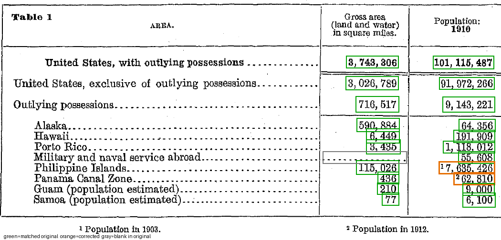

# OCR로 표 이미지를 다시 쓰기 — Census Table 1

"AI가 이미지를 읽기까지" 선택 과제 **B**입니다. 1910년 미국 인구조사 보고서의 표 이미지(Table 1, 면적과 인구)를 PaddleOCR로 읽었습니다. 읽은 글자를 좌표로 행·열에 연결해 검색·복사할 수 있는 CSV와 Markdown 표로 복원했습니다. 각 값은 원본 이미지와 대조해 확인했습니다.

- 최종 결과: [`outputs/ocr/document.md`](outputs/ocr/document.md), [`outputs/ocr/table.csv`](outputs/ocr/table.csv)
- 실행 기록: [`outputs/ocr/manifest.json`](outputs/ocr/manifest.json)

## 결과 요약

| 항목 | 값 |
|---|---|
| OCR이 찾은 글자 영역 | 41개 |
| 표의 숫자 칸 | 22칸 (11행 × 면적·인구) |
| 원본과 일치 | 19칸 |
| 원본 대조 후 수정 | 2칸 (각주 위첨자가 숫자에 붙음) |
| 원문에 값 없음 | 1칸 |
| 판독 불가 | 0칸 |
| 합계 검산 | 수정 전 4개 중 1개 실패 → 수정 후 4개 모두 통과 |

### 발견한 오류
| 위치 | 원시 OCR | 원본 | OCR 점수 |
|---|---|---|---|
| Philippine Islands / 인구 | `17,635,426` | ¹ 7,635,426 | 0.989 |
| Panama Canal Zone / 인구 | `262,810` | ² 62,810 | 0.945 |

두 값 모두 점수가 높아서 confidence로는 걸러지지 않았습니다. 표 안의 합계 관계로 검산했을 때 Outlying possessions 인구 소계가 정확히 +10,200,000 어긋났습니다. 그 차이를 따라 원본을 확대해 보고 원인을 찾았습니다.



*초록 = 원본과 일치, 주황 = 원본 대조 후 수정, 회색 = 원문에 값 없음*

## 실행 위치와 도구 선택 이유

- **실행 위치:** 로컬 Windows PC, CPU, Python 3.11.9, 이 폴더의 `.venv` 가상환경
- **PaddleOCR 3.7.0:** 문자열과 함께 글자 영역 좌표를 줍니다. 좌표가 있어야 행·열을 연결할 수 있고, 각 값이 원본의 어디서 왔는지 되짚을 수 있습니다. 영어(`lang="en"`)를 쓰면 기본 모델로 `PP-OCRv6_medium_det` / `PP-OCRv6_medium_rec`가 선택됩니다.
- **표 구조 도구 대신 좌표 규칙을 썼습니다.** 표가 11행 3열로 작고, 원본의 세로 괘선 위치가 분명합니다. 규칙(열 경계 x, 같은 행 ±12px)을 코드에 그대로 적어 두면 연결 근거를 누구나 확인할 수 있습니다.
- **합계 검산을 넣었습니다.** 이 표는 "세부 합 = 소계", "소계 + 본토 = 총계" 관계가 있어서, 사람이 22칸을 다 보기 전에 계산으로 의심 칸을 좁힐 수 있습니다.
- **설정을 바꾼 이유**
  - 문서 방향·왜곡 보정을 껐습니다. 스캔이 이미 똑바로 서 있기 때문입니다.
  - `enable_mkldnn=False`로 설정했습니다. Windows CPU에서 oneDNN 경로가 `NotImplementedError`로 실패했기 때문입니다(첫 실행 로그로 확인).

## 실행 방법

```bash
python -m venv .venv
```

```bash
.venv\Scripts\python.exe -m pip install -r requirements.txt
```

```bash
.venv\Scripts\python.exe outputs\ocr\ocr_run.py
```

```bash
.venv\Scripts\python.exe outputs\ocr\build_table.py
```

```bash
.venv\Scripts\python.exe outputs\ocr\make_crops.py
```

```bash
.venv\Scripts\python.exe outputs\ocr\review.py
```

```bash
.venv\Scripts\python.exe outputs\ocr\make_manifest.py
```

- 처음 실행할 때 OCR 모델 두 개(약 140MB)가 `%USERPROFILE%\.paddlex\official_models\`에 자동으로 내려받아집니다.
- 한글 출력이 깨지면 PowerShell에서 `$env:PYTHONIOENCODING='utf-8'`를 먼저 설정하세요.

| 스크립트 | 하는 일 | 만드는 파일 |
|---|---|---|
| `ocr_run.py` | OCR 실행 | `census-table_res.json`, `ocr_lines.csv`, `census-table_ocr_res_img.png`, `input_census-table.png` |
| `build_table.py` | 좌표로 행·열 연결, 검산 (사람 수정 없음) | `table_raw.csv`, `table_raw.md`, `checks_raw.json` |
| `make_crops.py` | 의심 칸 4배 확대 | `crops/*.png` |
| `review.py` | 원본 대조 결과 반영 | `table.csv`, `document.md`, `review_overlay.png`, `checks.json` |
| `make_manifest.py` | 환경·버전·설정 기록 | `manifest.json` |

원시 결과(`census-table_res.json`, `table_raw.csv`)는 수정하지 않고 보존합니다. 사람이 판단한 수정은 `review.py`의 `CORRECTIONS`에 이유와 근거 이미지와 함께 따로 적었습니다.

## 확인 필요 · 한계

- **열 제목과 실제 연도:** 열 제목은 "Population: 1910"이지만 Philippine Islands는 1903년, Panama Canal Zone은 1912년 값입니다(원문 각주). 원문의 소계와 총계에도 그대로 더해져 있습니다. 그래서 `table.csv`에 `population_year` 열을 두었습니다.
- **추정치:** Guam과 Samoa는 원문에 추정치로 적혀 있습니다.
- **좌표 규칙의 범위:** 열 경계 픽셀값은 이 이미지에 맞춘 값입니다. 다른 표에 그대로 쓸 수 없습니다.
- **검토자:** 원본 대조는 코딩 에이전트(Claude)가 확대 이미지로 수행했습니다. 제출 전에 `review_overlay.png`와 `crops/`를 직접 열어 최종 확인해야 합니다.

## 처음 예상과 실제 결과

> 과제를 시작하기 전에 메모한 예측을 여기에 적고 실제 결과와 비교하세요. (직접 작성)
>
> - 예상한 오류:
> - 실제로 나온 오류: 각주 위첨자가 숫자에 붙음(2건), 점수는 높았음
> - 달라진 점:

## 입력 자료 출처

미국 인구조사국, *Thirteenth Census of the United States, Volume 1* (1913년 발행), PDF 2쪽 · 인쇄 22쪽. 미국 연방정부 발행물이라 퍼블릭 도메인입니다. 표 이미지는 과제에서 제공한 200 dpi 추출본입니다.
<https://www2.census.gov/library/publications/decennial/1910/volume-1/volume-1-p3.pdf>
